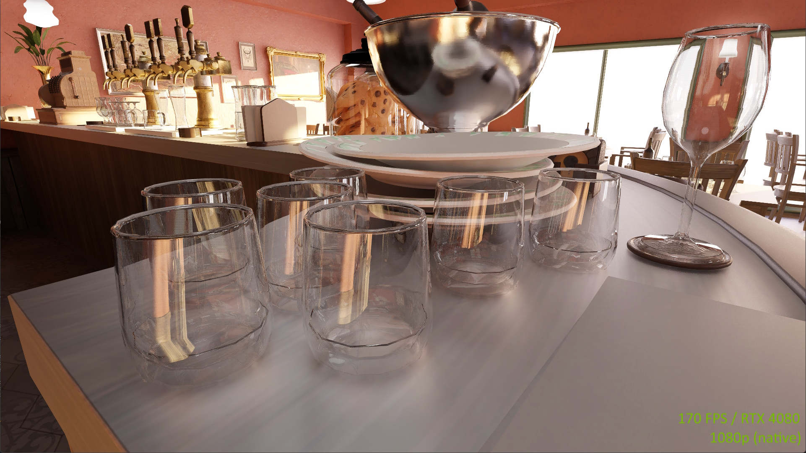
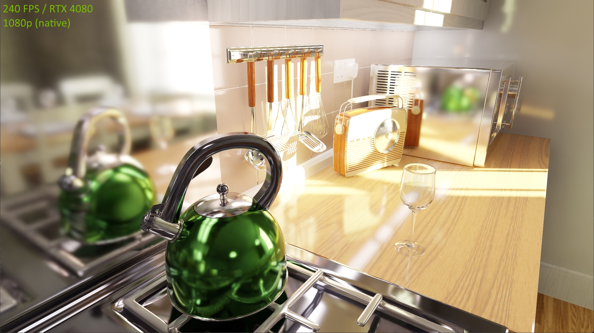

# *NRD* SAMPLE

*NRD* Sample is a real-time path tracer for games, a reference for [*NRD*](https://github.com/NVIDIA-RTX/NRD) integration, and a source of path tracing goodness to borrow. The sample demonstrates production-ready path tracing best practices for real-time games, balancing image quality and high performance, including realistic glass rendering. Its techniques are already used in several *AAA* games and game mods, including Dark Souls 2 & 3 *PT*.

The [tracer](Shaders/RaytracingShared.hlsli) uses:

- *HW ray queries* and optimized per-triangle shading data, without vertex/index gathers at hits
- separate `GeometryProps` and `MaterialProps` for optimal geometry and material evaluation
- small live state and tracing payloads
- efficient and lightweight *Ray Cones* implementation for texture mip selection

Rendering pipeline:

- [*Update radiance cache*](Shaders/SharcUpdate.cs.hlsl)
  - world-space [*SHARC*](https://github.com/NVIDIA-RTX/SHARC) radiance (*L2*) cache is populated here, including surfaces seen through mirrors and glass
  - retracing previous samples finds lighting changes for [*NRD* history confidence](https://github.com/NVIDIA-RTX/NRD#history-confidence)
- [*Trace opaque*](Shaders/TraceOpaque.cs.hlsl)
  - Primary Surface Replacement (*PSR*) follows mirrors before denoising
  - *LightBVH*-based importance sampling uses Monte Carlo filtering over rays from any lobe sampler, including hair:
    - scale the candidate count up or down to fit the hardware
    - can query analytical lights with regular compute instead of *HW ray queries*
    - can extend the weights with a phase function to handle light directionality
  - paths reuse the previous denoised frame (*L1 radiance cache*), falling back to *SHARC (L2)* when screen-space reuse fails
  - the path tracer never produces high energy fireflies, making the input friendly for denoising
- [*Denoise*](https://github.com/NVIDIA-RTX/NRD) *and compose*
  - *REBLUR/RELAX* denoise diffuse and specular
  - *SIGMA* handles sun shadows
  - [composition](Shaders/Composition.cs.hlsl) reapplies material factors removed before denoising and optionally performs *SH/SG* resolve and rejittering to recover sub-pixel details
- [*Trace transparent*](Shaders/TraceTransparent.cs.hlsl)
  - reflections and transmission reuse current-frame lighting (*L1 radiance cache*), falling back to *SHARC (L2)* to offer less noise in lighting
  - *TAA/upscaler* handles the remaining noise using estimated motion vectors for transparent media
  - no separate glass denoiser is in use

Branches:

- [main](https://github.com/NVIDIA-RTX/NRD-Sample/tree/main) - primary use-case based on probabilistic lobe selection, start here to learn or borrow code
- [sandbox](https://github.com/NVIDIA-RTX/NRD-Sample/tree/sandbox) - all rendering options and *NRD* development tests

Also included:

- *D3D12* and *Vulkan* via [*NRI*](https://github.com/NVIDIA-RTX/NRI)
- *DLSS-SR/FSR/XeSS* upscaling working in conjunction with [*NRD SG/SH* resolve and re-jittering](https://github.com/NVIDIA-RTX/NRD#interaction-with-upscaling-dlssfsrxesstaau)
- *DLSS-RR* comparisons
- *RTXCR* hair and skin subsurface scattering
- checkerboard tracing and more in `sandbox` branch

## HOW TO BUILD

- Install [*CMake*](https://cmake.org/download/) 3.30+
- Install [*Git LFS*](https://git-lfs.com/) when using `RTXCR_INTEGRATION` (enabled by default)
- Build (variant 1) - using *Git* and *CMake* explicitly
    - Clone project and init submodules
    - Generate and build project using *CMake*
    - To build the binary with static *MSVC* runtime, add `-DCMAKE_MSVC_RUNTIME_LIBRARY="MultiThreaded$<$<CONFIG:Debug>:Debug>"` parameter when deploying the project
- Build (variant 2) - by running scripts:
    - To deploy the project, run `Scripts/<Platform>/1-Deploy`
    - To build the project, run `Scripts/<Platform>/2-Build`
    - To clean generated files, run `Scripts/<Platform>/4-Clean`

`<Platform>` is `Windows` or `Linux`. Use `.bat` on Windows; run `.sh` scripts with `bash` on Linux. Scripts resolve the project root from their own location.

*CMake* options:

- `RTXCR_INTEGRATION` - use *RTXCR* for hair and skin rendering, download sample scene

## HOW TO RUN

- Run `Scripts/Windows/3-Run.bat` script and answer the cmdline questions to set the runtime parameters
- If [Smart Command Line Arguments extension for Visual Studio](https://marketplace.visualstudio.com/items?itemName=MBulli.SmartCommandlineArguments) is installed, all command line arguments will be loaded into corresponding window
- The executables can be found in `_Bin`. The executable loads resources from `_Data`, therefore please run the samples with working directory set to the project root folder (needed pieces of the command line can be found in `Scripts/Windows/3-Run.bat` script)

Requirements:
- any *GPU* supporting *HW ray queries*

## USAGE

*NRD* defaults to `NORMAL` mode. For spherical harmonics / spherical Gaussian (*SH/SG*) resolve, set `NRD_MODE` to `SH` in [Shaders/Shared.hlsli](Shaders/Shared.hlsli) and rebuild. Use `SH` when comparing *NRD* with *DLSS-RR*, especially with upscaling.

Controls:
- Right mouse button + W/S/A/D - move camera
- Mouse scroll - accelerate / decelerate
- F1 - toggle "gDebug" (can be useful for debugging and experiments)
- F2 - go to next test (only if *TESTS* section is unfolded)
- F3 - toggle emission
- Tab - UI toggle
- Space - animation toggle
- PgUp/PgDown - switch between denoisers
